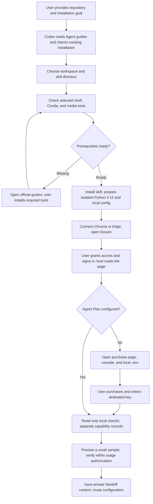
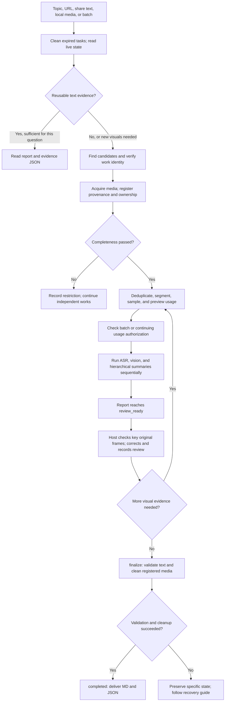
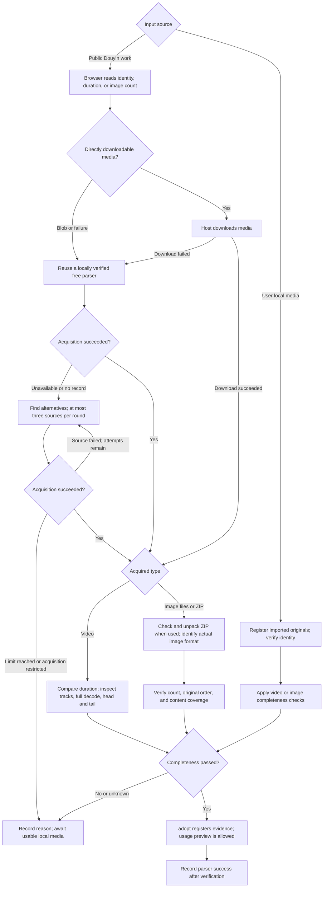
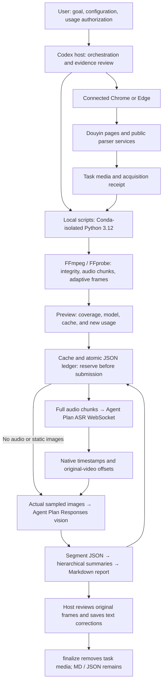
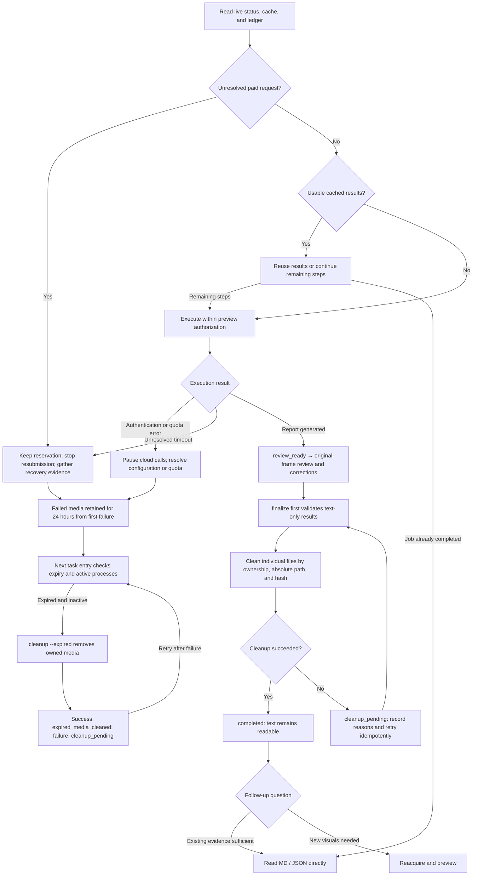

English · [简体中文](README.md)


# douyin-agent

**Let Codex understand Douyin videos and image posts, and keep traceable knowledge.**

Provide a topic, work URL, share text, or local media. Codex verifies and acquires the work through connected Chrome / Edge. Local scripts check completeness, and Volcengine Agent Plan transcribes speech and analyzes visuals. After key-evidence review, retain Markdown / JSON and remove task-owned temporary media.

Short videos, long videos, image posts, and batches share one workflow. Audio receives full coverage; visuals use adaptive sampling. Reports distinguish recognized speech, visual observations, and inference.

## Install with one request

Send the repository URL and this prompt to Codex with local terminal, file, and browser capabilities:

```text
Install https://github.com/HNNUYUXUAN/douyin-agent
Read AGENTS.md and AGENT_INSTALL.md; inspect existing versions and local prerequisites.
Reuse my PowerShell or Git Bash and existing Conda; prepare an isolated workspace.
Help me connect Chrome or Edge, open Douyin, and configure Agent Plan.
Open the required pages or local file when I need to sign in, purchase, or enter a key.
```

[GitHub](https://github.com/HNNUYUXUAN/douyin-agent) · [GitCode mirror](https://gitcode.com/yuxuan6426/douyin-agent) · [Agent installation entry](AGENT_INSTALL.md)

For a new device with only WorkBuddy and its Chrome/Edge connector, start with the [modular zero-start guide](references/bootstrap/en/first-run.md). It covers source, Conda/FFmpeg, WorkBuddy discovery and the first task. Use the [Google OKF Wiki](wiki/index.md) for operational knowledge; other-device success requires actual acceptance evidence.

## Prepare the environment

| Layer | Purpose and preparation |
|---|---|
| Windows terminal | Choose Windows PowerShell 5.1, PowerShell 7, or Git Bash. The host locates and checks the actual executable/version, reusing system or host-bundled tools. |
| Conda | Discover existing Miniconda, Anaconda, or compatible Conda. Base Python 3.10+ launches the installer. Open the official installation guide if missing. |
| Isolated runtime | Lockfiles create workspace Python 3.12. Call that interpreter directly afterward; `conda activate` is unnecessary. |
| Media tools | FFmpeg / FFprobe on PATH handle probing, decoding, audio preparation, and frame extraction. |
| Browser | Host-connected Chrome / Edge handles online search and acquisition. Open Douyin in the same profile and sign in as needed. Local imports go directly to media checks. |
| Agent Plan | The user purchases an applicable plan and enters its dedicated key as `VOLC_AGENT_API_KEY` in workspace `.env`. Process environment variables take priority. |

Codex opens the needed pages during onboarding: [browser connection](https://learn.chatgpt.com/docs/chrome-extension), [Douyin](https://www.douyin.com/), [Agent Plan purchase](https://www.volcengine.com/activity/agentplan), [console](https://ark.volcengine.com/region:cn-beijing/openManagement?LLM=%7B%7D&advancedActiveKey=agentPlan), and [configuration guide](https://docs.volcengine.com/docs/ark/agent-plan-personal-get-started?lang=zh). Official tool entries: [Miniconda](https://www.anaconda.com/docs/getting-started/miniconda/install), [PowerShell](https://learn.microsoft.com/powershell/scripting/install/installing-powershell-on-windows), [Git for Windows](https://gitforwindows.org/), and [FFmpeg](https://ffmpeg.org/download.html).

Reuse existing configuration according to actual checks. Users complete sign-in, CAPTCHA, purchases, and local key entry. The skill is free and open source; Codex and cloud services have their own charges. Current plan benefits are defined by the provider.

Choose the command for your terminal at the downloaded repository root:

**PowerShell 5.1 / 7**

```powershell
./install.ps1 -Workspace 'D:\douyin-agent'
# Optional: -SkillDir 'C:\Users\YOUR_USER\.codex\skills\douyin-agent'
# Optional: -Conda 'C:\PATH_TO_CONDA\Scripts\conda.exe'
```

**Git Bash**

```bash
bash ./install.sh --workspace '/d/douyin-agent'
# Optional: --skill-dir '/c/Users/YOUR_USER/.codex/skills/douyin-agent'
# Optional: --conda '/c/PATH_TO_CONDA/Scripts/conda.exe'
```

Omitting the workspace prompts for a location: `D:\douyin-agent` when D: exists, otherwise a short path under the user directory. The skill directory defaults to `$CODEX_HOME/skills/douyin-agent`, or the current user's `.codex/skills/douyin-agent` when unset. Keep workspace and skill directories separate; quote paths containing spaces.

To prepare or rebuild only the environment, use `./setup.ps1 -Workspace 'D:\douyin-agent'` or `bash ./setup.sh --workspace '/d/douyin-agent'`. Both shells use one Python installation core. Conda selection order: explicit parameter → `CONDA_EXE` → PATH → common locations under the user directory and ProgramData.

## The complete workflow

The diagrams are maintained directly in Markdown. If your client does not display Mermaid, use the text steps below each diagram or the [GitCode page](https://gitcode.com/yuxuan6426/douyin-agent/blob/main/README.en.md).

### 1. Installation and first-time setup



Steps: read guides → choose directories → check shell and Conda → install runtime → connect browser and Douyin → configure Agent Plan → preview and verify. `doctor`, `status`, and `onboard --check` are read-only. Browser access, login state, and real service calls are verified separately.

### 2. From task to delivery



Steps: verify → acquire and check completeness → preview → authorize → analyze → review → `finalize` → deliver. Additional media or expanded scope creates a new preview. Batches deduplicate by work ID or media hash; browser operations and cloud calls run sequentially by default.

### 3. How media is acquired



The host operates direct downloads and parser services. Parsers receive only public work URLs. Verified sources are registered locally and revalidated on other hosts. Video duration tolerance is the larger of one second or two frame durations; absent reliable source duration means completeness is unknown. Image posts retain original order; a separate tool checks ZIPs before image import. Restricted works retain their reason while independent works continue. See [acquisition](docs/agent/en/acquisition.md).

### 4. System and cloud data flow



Videos with audio receive full-audio transcription, followed by actual-image analysis and synthesis with the transcript. Videos without audio and static image posts skip ASR. Long-audio chunks preserve server-native timing plus global offsets. Visual evidence is organized into one-minute sections. Hierarchical summary requests enter the preview in advance; cloud requests have automatic retries disabled.

| Interface or record | Responsibility |
|---|---|
| `wss://openspeech.bytedance.com/api/v3/plan/sauc/bigmodel_nostream` | Agent Plan single-stream ASR; resource ID `volc.seedasr.sauc.duration`. |
| `https://ark.cn-beijing.volces.com/api/plan/v3/responses` | Visual understanding and synthesis; configurable model, default `doubao-seed-2.1-pro`. |
| Cache and ledger | Reuse by media hash, model, processing configuration, and independent prompt/protocol versions. Submission amounts, returned usage, and platform settlement are recorded separately. |
| Review record | Links time or image order, evidence IDs, hashes, textual observations, and current report hash. |

### 5. Lifecycle, cleanup, and recovery



Completed cache results can be delivered directly; partially completed jobs execute only remaining steps. Unresolved requests retain their reservations and currently require evidence gathering and maintainer assistance under [recovery](docs/agent/en/recovery.md); a new task must not bypass protection. Expired failed jobs become `expired_media_cleaned` after cleanup. Only reviewed, text-validated, successfully cleaned jobs become `completed`. `doctor/status` do not clean media; no background scheduler is installed.

## Outputs and cleanup

| Retained | Removed after review | Preserved for the user |
|---|---|---|
| `analysis.md`, segment understanding, native transcript-timing JSON, source/evidence index, request and cleanup records | Registered task-owned video, audio, sampled frames, original images, temporary ZIPs, and browser download copies | Imported originals, isolated environment, source, private configuration |

Durable reports use source URLs, times, image order, hashes, and textual observations. Recognized speech, visual results, and inference are labeled separately. New visual questions after cleanup require acquisition again. Deleted, private, paid, live, or persistently incomplete works receive an explicit restriction report.

## Real case summaries

| Case | Verified result | Evidence |
|---|---|---|
| [2:54 recursion video](https://www.douyin.com/video/7683763028419956019) | 174.375 audio seconds, 68 frames, 15 requests; six key frames reviewed. | [Summary](docs/cases/short.en.md) · [JSON](docs/cases/short.json) |
| [8:26 recursion video](https://www.douyin.com/video/7493866919565610291) | 506.21678 audio seconds, 102 frames, 22 requests; formulas, code boundaries, and timing reviewed. | [Summary](docs/cases/long.en.md) · [JSON](docs/cases/long.json) |
| [Nine C-language note pages](https://www.douyin.com/note/7699716622642105615) | ZIP fallback, three requests; original order checked and key character recognition corrected. | [Summary](docs/cases/note.en.md) · [JSON](docs/cases/note.json) |

All three completed review, media cleanup, and validation after cleanup. These are v2.1 live records; submissions and platform settlement are separate. See [acceptance](references/acceptance.md) for current terminal and installation verification.

## Agent documentation and license

[AGENTS.md](AGENTS.md) routes repository tasks; [AGENT_INSTALL.md](AGENT_INSTALL.md) covers installation; [SKILL.md](SKILL.md) routes installed-skill requests. [llms.txt](llms.txt) and the [bilingual index](docs/agent/index.json) provide intent-based navigation.

Guides: [install/upgrade](docs/agent/en/install.md) · [onboarding](docs/agent/en/onboarding.md) · [acquisition](docs/agent/en/acquisition.md) · [understanding/delivery](docs/agent/en/workflow.md) · [recovery/cleanup](docs/agent/en/recovery.md) · [maintenance](docs/agent/en/maintenance.md).

Windows Codex is the current validation environment. Chrome has real acquisition and understanding evidence; Edge, other hosts, and other devices require their own records. Original code is [MIT licensed](LICENSE); see [dependency notices](THIRD_PARTY_NOTICES.md). Code licensing does not grant redistribution rights to third-party works.
