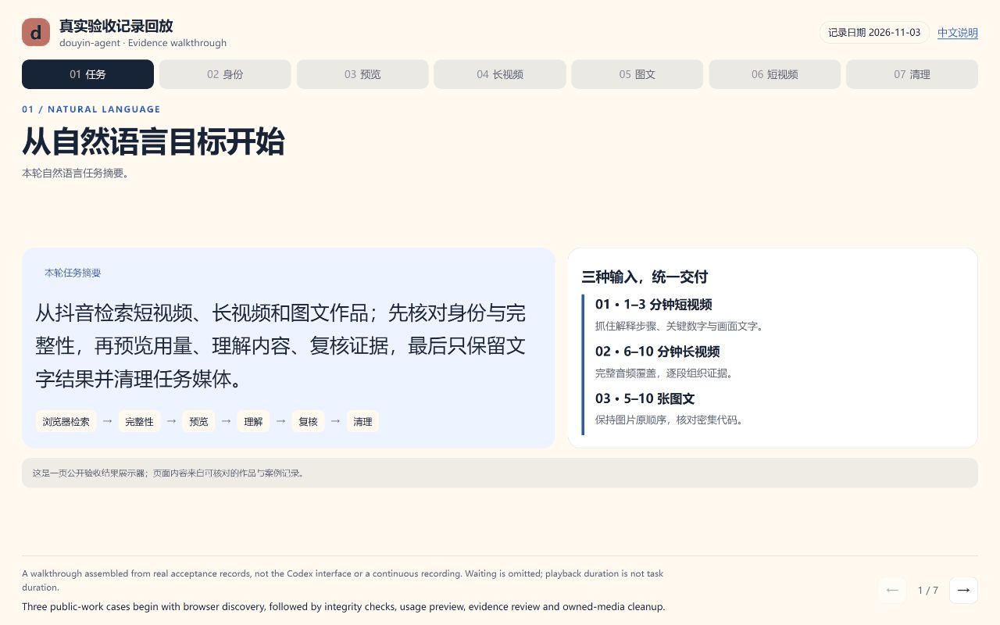
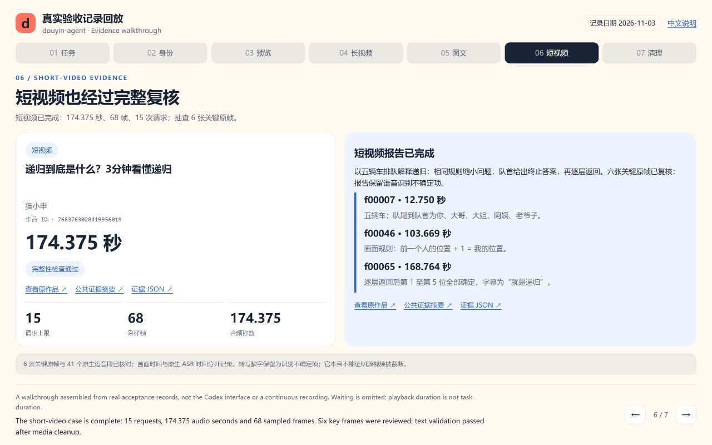
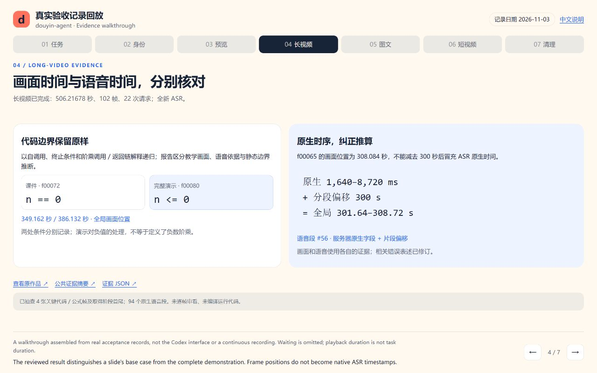
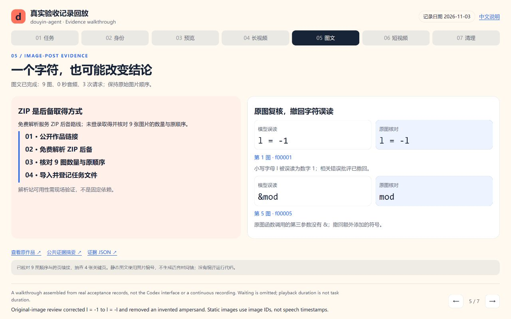
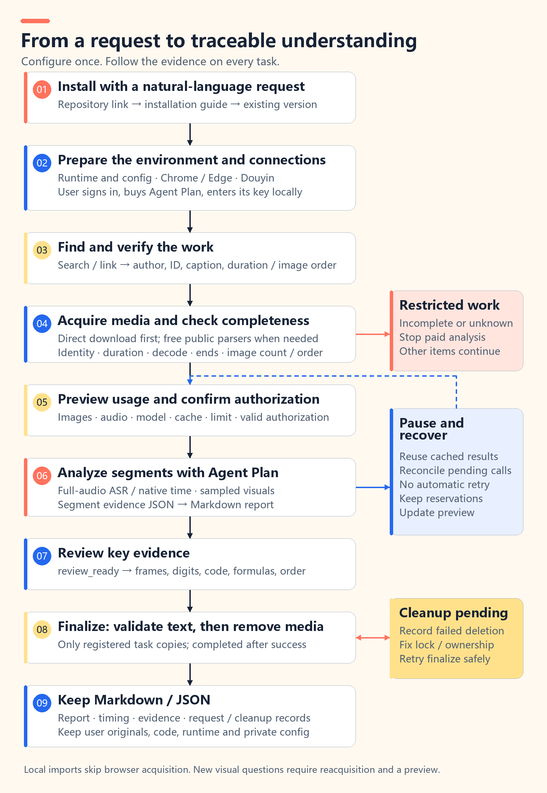
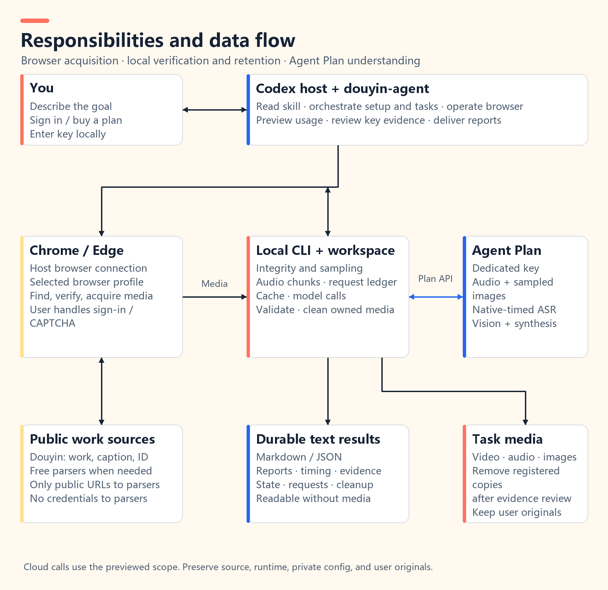

English · [简体中文](README.md)


# douyin-agent

**Turn Douyin videos and image posts into notes you can trace back to the evidence.**

Give Codex a topic, share text, or a work URL. It uses your connected browser to find and verify the work, acquires the media, and checks completeness. Volcengine Agent Plan transcribes the audio and analyzes the visuals. After review, the task retains Markdown / JSON and removes the media it downloaded.

[Get started](#get-started) · [See the workflow](#see-the-workflow) · [First-time setup](#first-time-setup) · [How it works](#how-it-works)

## Get started

Send this prompt and the repository URL to Codex:

```text
Install douyin-agent from https://github.com/HNNUYUXUAN/douyin-agent.
Read AGENTS.md and AGENT_INSTALL.md, check for an existing version,
install with install.ps1, and guide me through first-time setup.
Prefer D:\douyin-agent for the workspace; let me choose another location if D: is unavailable.
Help me connect Chrome or Edge, open Douyin, and configure Agent Plan.
When sign-in, a purchase, or a key is needed, prepare the page or local file for me to complete.
```

You can also install from [GitCode](https://gitcode.com/yuxuan6426/douyin-agent). Use one source and version per installation. Agents start at the [installation entry](AGENT_INSTALL.md) and use the [operation index](docs/agent/index.json) to select the current step.

Then describe the task:

```text
Find a Douyin video explaining binary search.
Verify completeness and show the usage preview before analyzing the explanation and code.
Keep the report and evidence JSON, then remove the media downloaded for this task.
```

Online acquisition uses **Windows Codex with connected Chrome / Edge**. Local imports can skip browser acquisition. You need a dedicated Python 3.12 environment, FFmpeg / FFprobe, and a valid Agent Plan API key. Chrome has local test evidence; see [acceptance status](references/acceptance.md) for other browsers and devices.

## See the workflow



Seven screens present records from three real acceptance cases: task intent, source identity, usage preview, evidence review, and cleanup. This is an evidence walkthrough, not the Codex interface or a continuous screen recording. Waiting is omitted; playback duration is not task processing time. [Walkthrough source](docs/demo.html). After cloning, run `python -m http.server 8766 --bind 127.0.0.1` at the repository root and open `http://127.0.0.1:8766/docs/demo.html?lang=en` for interactive viewing.

Reports organize the content into traceable sections: what was said, when it appeared, what the images show, and what remains uncertain. Transcripts preserve server-provided timing; visual observations reference image IDs for review.

## Three tasks, from discovery to results


### Short videos: capture the point and check the details

```text
Find a 1–3 minute educational video on Douyin.
Analyze its main claims, supporting evidence, and on-screen text.
Show the selected work and usage preview before starting analysis.
```

Deliverables focus on key claims, timestamps, important numbers, and the relationship between speech and visuals.



Tested work: 猫小申’s [《递归到底是什么？3分钟看懂递归》](https://www.douyin.com/video/7683763028419956019), approximately **2 minutes 54 seconds** long. This run analyzed **68 sampled frames**, transcribed all **174.375 audio seconds**, and recorded **15 requests**. Review of six key frames verified the order of five cars, the base case, and the return sequence. Missing ASR words remain marked as uncertain. The report completed, task media was removed, and validation passed after cleanup.

[Read the short-video evidence summary](docs/cases/short.en.md) · [View the evidence JSON](docs/cases/short.json). The screenshot shows key evidence and review results from the actual report.

### Long videos: follow the sections and connect the reasoning

```text
Find a 6–10 minute technical explanation on Douyin.
Organize its reasoning by time segment, check code and formulas,
and retain conclusions that need further confirmation.
```

Deliverables focus on full-audio transcription, segment-level understanding, key evidence, and an overview. Visual analysis uses adaptive samples distributed across the video.



Tested work: 林粒粒呀’s [《8分钟搞懂“编程的鬼打墙”——递归》](https://www.douyin.com/video/7493866919565610291), approximately **8 minutes 26 seconds** long. This run found and acquired the work through the browser, produced a new full-audio transcript, and analyzed **102 sampled frames**. It recorded **22 requests**: 2 ASR, 17 visual analysis, 2 hierarchical summaries, and 1 report. Key evidence was reviewed; the job completed, its media was removed, and validation passed after cleanup.

[Read the long-video evidence summary](docs/cases/long.en.md) · [View the evidence JSON](docs/cases/long.json). The screenshot shows the code-boundary and timing review: `n == 0` and `n <= 0` are kept distinct, as are native ASR timing and frame positions. The code shown in the video was not compiled or executed.

### Image posts: preserve the sequence and read images with their caption

```text
Find a Douyin image post containing 5–10 images.
Explain each image in its original order, then summarize it with the author's caption.
Flag any text that is unclear or cannot be confirmed.
```

Deliverables focus on image count and order, individual observations, visible text, and how the caption relates to the images.



Tested work: C语言模型笔记📝’s [《C语言 数论与大数运算，一组笔记讲清楚》](https://www.douyin.com/note/7699716622642105615). A free-parser ZIP fallback provided **nine images** whose count and original order were verified. The run recorded **three requests** and **zero audio seconds**. Review of four key pages corrected a letter `l` misread as digit `1` and an invented `&`. The report completed, task images and registered download copies were removed, and validation passed after cleanup.

[Read the image-post evidence summary](docs/cases/note.en.md) · [View the evidence JSON](docs/cases/note.json). The screenshot shows sequence checks and character corrections; no parser service is a fixed dependency.

All three cases began with browser discovery of new works. Together they recorded **40 requests, 680.59178 audio seconds, and 179 images / frames**. All completed review, cleanup, and validation after cleanup. These figures describe this run’s submissions; platform settlement, other tasks’ usage, and processing time are recorded separately.

## First-time setup

Codex follows the [first-use guide](docs/agent/en/onboarding.md) to prepare the environment, open the relevant pages, and check status. You sign in, make any purchase, and enter the key locally. Existing configuration is reused. `onboard --check` is read-only; the host separately verifies and records browser connection, Douyin access, and a real model call.

| Requirement | Codex prepares | You complete |
|---|---|---|
| Local workspace | A short path, existing Conda discovery, a dedicated environment, and a configuration file | Choose the location; follow official installation guidance if tools are missing |
| Browser connection | Official extension setup guidance and a page-read check | Connect Chrome / Edge and grant website access |
| Douyin | A work or search page in the same browser profile | Sign in if needed and complete any CAPTCHA |
| Agent Plan | The purchase page, console, and local configuration file | Choose a plan and copy its dedicated API key into `.env` |
| Initial validation | Local checks and a small-sample usage preview before testing the service | Approve this batch or a continuing usage allowance |

[Browser connection guide](https://learn.chatgpt.com/docs/chrome-extension) · [Open Douyin](https://www.douyin.com/) · [Agent Plan purchase page](https://www.volcengine.com/activity/agentplan) · [Agent Plan console](https://ark.volcengine.com/region:cn-beijing/openManagement?LLM=%7B%7D&advancedActiveKey=agentPlan) · [Official setup guide](https://docs.volcengine.com/docs/ark/agent-plan-personal-get-started?lang=zh)

Enter the **dedicated Agent Plan key** as `VOLC_AGENT_API_KEY` in the workspace `.env`; do not send it in chat. The skill is open source and free to use. Codex and cloud model services have their own charges; current plan pricing and benefits are shown on the purchase page.

<details>
<summary>Manual installation and environment rebuild</summary>

From the downloaded repository root, use PowerShell 7:

```powershell
./install.ps1 -Workspace 'D:\douyin-agent'
```

The installer prepares a dedicated environment and installs the allowlisted skill files into the host discovery directory. It defaults to `$CODEX_HOME/skills/douyin-agent`, or the current user’s `.codex/skills/douyin-agent` when `CODEX_HOME` is unset. To choose a skill directory or an existing Conda executable:

```powershell
./install.ps1 -Workspace 'D:\douyin-agent' `
  -SkillDir 'C:\Users\YOUR_USER\.codex\skills\douyin-agent' `
  -Conda 'C:\PATH_TO_CONDA\Scripts\conda.exe'
```

Replace the example paths with actual locations. Keep the workspace separate from the installed skill. Choose another short path if D: is unavailable, or omit `-Workspace` for interactive selection. Installation records the actual paths. Use the installation receipt and `agent-context.json` to locate Python, the skill, and the workspace; run `onboard --check`, then follow host-led onboarding. Refresh or restart the host if its UI requires it.

Use `./setup.ps1 -Workspace 'D:\douyin-agent'` only to rebuild the environment for existing source. `setup.ps1` does not install the skill into the host discovery directory. Both entrypoints reuse existing Conda; FFmpeg / FFprobe must be on PATH. `doctor` and `onboard --check` do not make paid calls. See [install and upgrade](docs/agent/en/install.md).

</details>

## How it works



The host first tries usable direct acquisition routes. If it encounters a `blob` URL or an acquisition failure, it reuses a verified free parser or searches for alternatives, trying at most three sources per round. Paid analysis begins only after identity, duration or image count, decoding, and the applicable visual checks pass. Image posts can use a parser-provided ZIP fallback when necessary. The host checks the archive, image count and order, then registers file ownership under the acquisition guide. Parser availability is verified at use time; no specific service is a fixed dependency.



Codex interprets the request, operates the browser, and reviews evidence. Local scripts handle integrity checks, sampling, caching, the request ledger, and cleanup. Agent Plan receives audio and sampled images and returns transcription and analysis. The upload scope appears in the usage preview; added media or a larger scope produces an updated preview.

## Keep the understanding, remove the media

| Retained | Removed after review | Preserved |
|---|---|---|
| Markdown reports, segment analysis, native transcript timing, evidence IDs and hashes, request and cleanup records | Task-owned videos, audio, sampled frames, source images, and registered download copies | User-imported originals, runtime, source code, and private configuration |

Completed results remain readable after media removal. New visual questions may require reacquisition. Failed deletion records the reason and leaves cleanup pending. Failed-task media expires 24 hours after the first failure and is handled at the next task entry; no background scheduler is installed.

Visual analysis is sampled and cannot guarantee that every frame was read. Without reliable native timing, the result retains text and states that limitation. Deleted, private, paid, live, or persistently incomplete works are reported as restricted. Timed-out cloud requests are not resubmitted automatically; unresolved reservations and submission history survive media cleanup.

## Documentation and license

Agent documentation is organized by task, with stable entrypoints for installation and use:

| Entry | Purpose |
|---|---|
| [AGENTS.md](AGENTS.md) | Repository rules and task routing |
| [AGENT_INSTALL.md](AGENT_INSTALL.md) | Repository installation, upgrades, and initial connection |
| [SKILL.md](SKILL.md) | Natural-language discovery and installed-skill execution rules |
| [llms.txt](llms.txt) | A compact documentation map for agents |
| [Operation index JSON](docs/agent/index.json) | Select a guide by language and task |

- [First use](docs/agent/en/onboarding.md): browser, Agent Plan, local configuration, and separate readiness checks.
- [Full workflow](docs/agent/en/workflow.md): commands, receipts, previews, and review.
- [Search, acquisition, and completeness](docs/agent/en/acquisition.md): browser discovery, direct downloads, parser fallbacks, and image order.
- [Recovery, cleanup, and migration](docs/agent/en/recovery.md): unresolved requests, caching, and lifecycle.
- [Acceptance status](references/acceptance.md): local tests, same-machine relocation, and untested environments.
- [MIT license](LICENSE) · [Third-party dependency licenses](THIRD_PARTY_NOTICES.md). The code license does not grant redistribution rights to third-party works.

Windows Codex is the primary environment with current test evidence. A separate Conda environment rebuilt successfully under a path with spaces on the same machine. Installation, repeat installation, local-modification conflict detection, upgrade from v2, and rollback under file locking were tested. Other devices and hosts require their own validation. Report issues with reproduction steps and redacted logs. Do not submit keys, cookies, signed download URLs, or private media.
