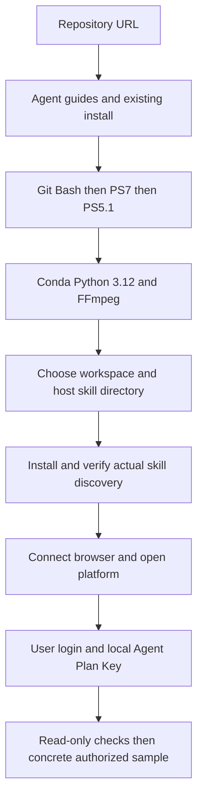
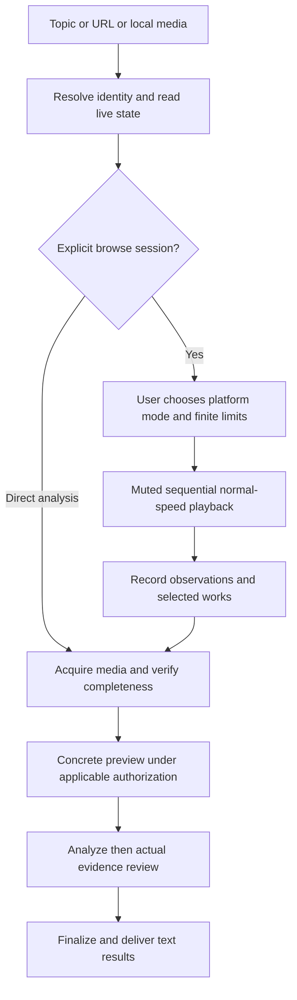
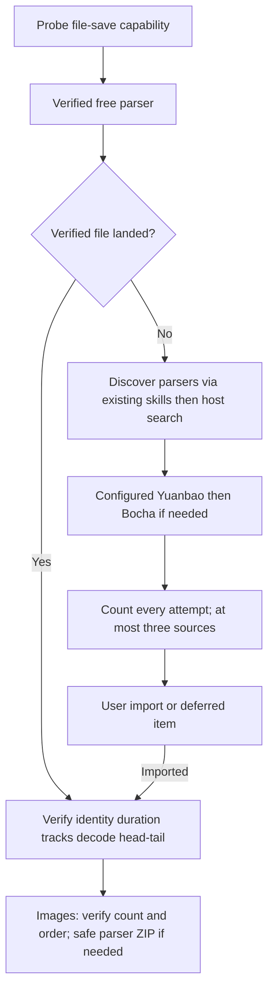
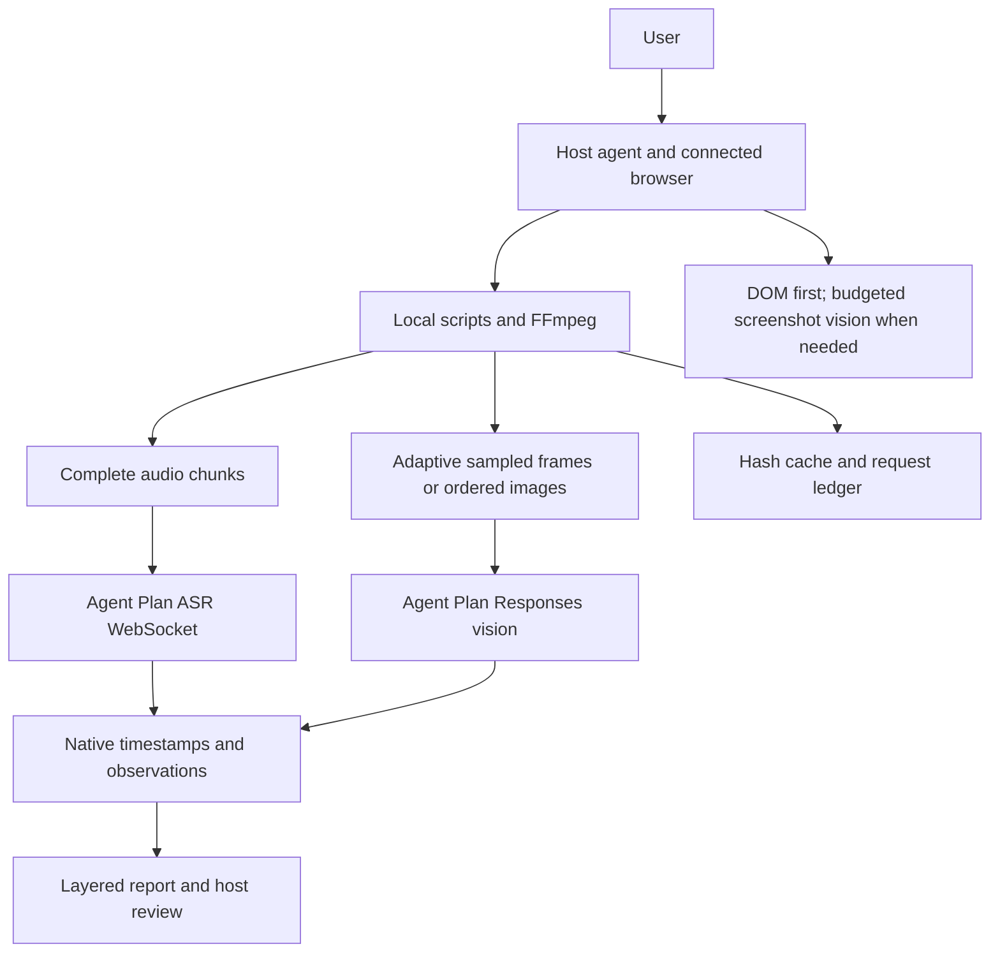
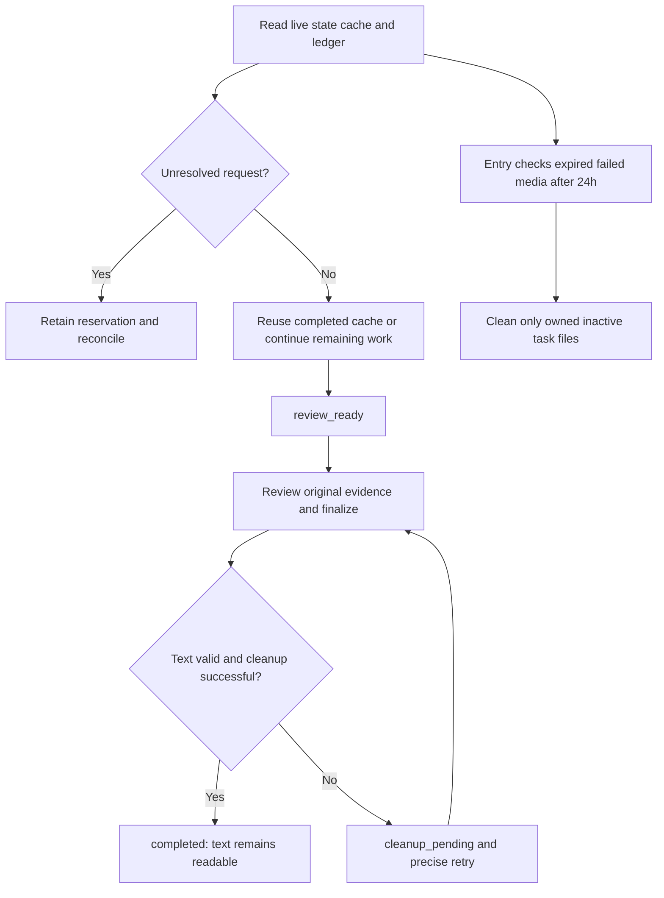

[简体中文](README.md) · English


# douyin-agent

A multi-platform video/image-post skill orchestrated by desktop agents including Codex and WorkBuddy. Supply a topic, shared URL or local media. Verify identity and completeness, use Volcengine Agent Plan for transcription and understanding, review evidence, retain Markdown/JSON and clean task-owned media.


Supports Douyin, YouTube, Xiaohongshu, TikTok and Bilibili videos/public image posts, including selected Bilibili parts. Media comes through free parser sites; accounts support browsing and identity checks.

## Install in natural language
```text
Install https://github.com/HNNUYUXUAN/douyin-agent
Read AGENTS.md and AGENT_INSTALL.md; for a new WorkBuddy device also read references/bootstrap/en/first-run.md.
Prefer existing Git Bash, then PowerShell 7, then Windows PowerShell 5.1.
Reuse Conda and prepare isolated Python 3.12, FFmpeg/FFprobe, browser and Agent Plan.
Open pages/local files for me when login, purchase, Key entry or system approval is needed.
```
[GitHub](https://github.com/HNNUYUXUAN/douyin-agent) · [GitCode](https://gitcode.com/yuxuan6426/douyin-agent) · [Zero-start](wiki/en/bootstrap/first-run.md)

Windows is the primary environment. Use the host's actual connected Chrome/Edge. Enter Keys locally and reuse valid configuration. Separate runtime workspace from skill location; new WorkBuddy installs default to user-level `.workbuddy/skills/douyin-agent`, subject to actual client discovery.

## Five complete workflow views

### 1. Install and onboard



Read guides, prepare dependencies and verify browser/service separately. The user handles login, purchase and local Key entry.

### 2. From request to delivery



Browse-only, selective and all-item analysis are explicit choices with no default spending mode.

### 3. Media acquisition



Parser success messages are not landed files. Count every attempt, defer blocked works and continue independent items.

### 4. System and data flow



Audio is fully covered; video vision is sampled. Version ASR, vision and summarization separately and retain native timing and uncertainty.

### 5. Lifecycle and recovery



No automatic paid resubmission. Viewing failed work does not renew its media expiry. No resident scheduler; doctor/status are read-only.

## Daily use and operation guides

After an explicit start, fill missing platform, mode, entry/topic, selection rules, time/item limits, image dwell and cloud allowance once. Continue within scope and collect deferred actions. Save progress on stop; resume requires an explicit request.

[Sessions](wiki/en/operations/browse.md) · [Controls](wiki/en/operations/platforms.md) · [Vision](wiki/en/operations/vision.md) · [Acquisition](wiki/en/operations/acquisition.md) · [Analysis](wiki/en/operations/workflow.md) · [Recovery](wiki/en/operations/recovery.md)

Retain source code, runtime, private configuration and imported originals. After review, clean task-owned video/audio/frames/images and registered download copies. Durable output is MD/JSON with native timing, evidence indexes, request and cleanup records.

## Cases and validation scope

Historical real [short-video](docs/cases/short.en.md), [long-video](docs/cases/long.en.md) and [image-post](docs/cases/note.en.md) summaries remain available. Current offline, terminal, browser, cloud and other-device evidence is separated in [acceptance](wiki/shared/acceptance/overview.md). TikTok is untested this round. Acquisition depends on actual platform/source conditions.

## Agent documentation and licensing

[AGENTS.md](AGENTS.md), [SKILL.md](SKILL.md), [machine index](docs/agent/index.json) and [llms.txt](llms.txt) route by intent. The [OKF Wiki](wiki/index.md) provides modular knowledge; private cases stay local. Original code uses [MIT](LICENSE); see [third-party notices](THIRD_PARTY_NOTICES.md). Third-party works retain their existing rights.

This run verified parser acquisition, understanding, review and cleanup for Douyin, YouTube, Xiaohongshu and Bilibili video/selected part/image post. Full-playback evidence is listed separately. Real Chrome/Edge combinations, WorkBuddy bridge repair and v2.5.0 clean-device installation remain pending; see [v2.5.0 evidence](wiki/shared/acceptance/v25.md).
