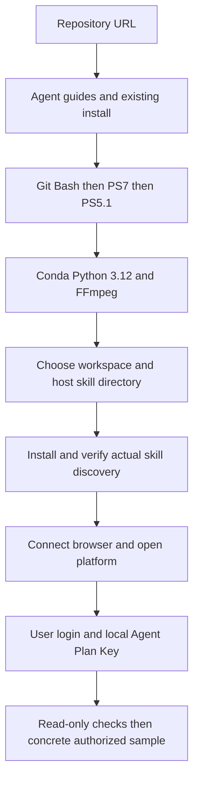
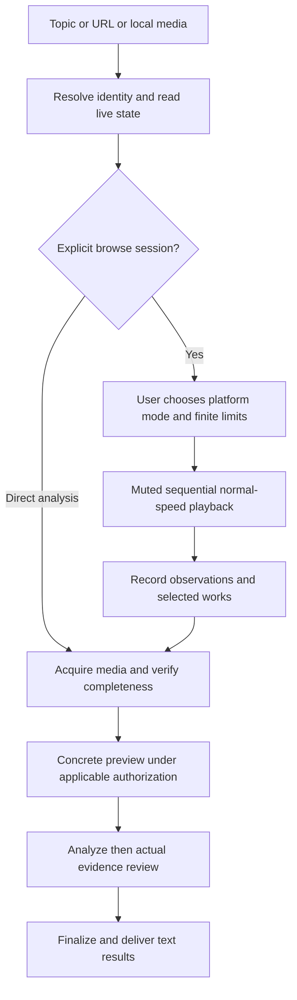
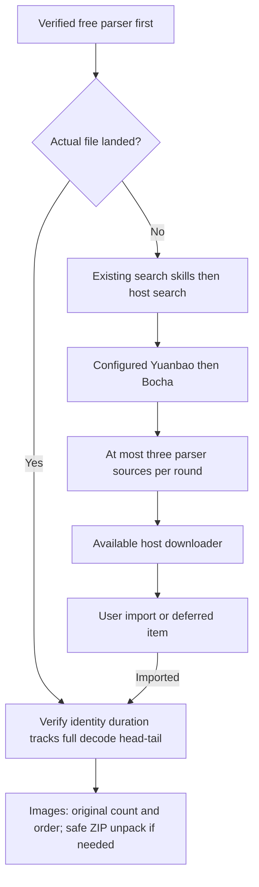
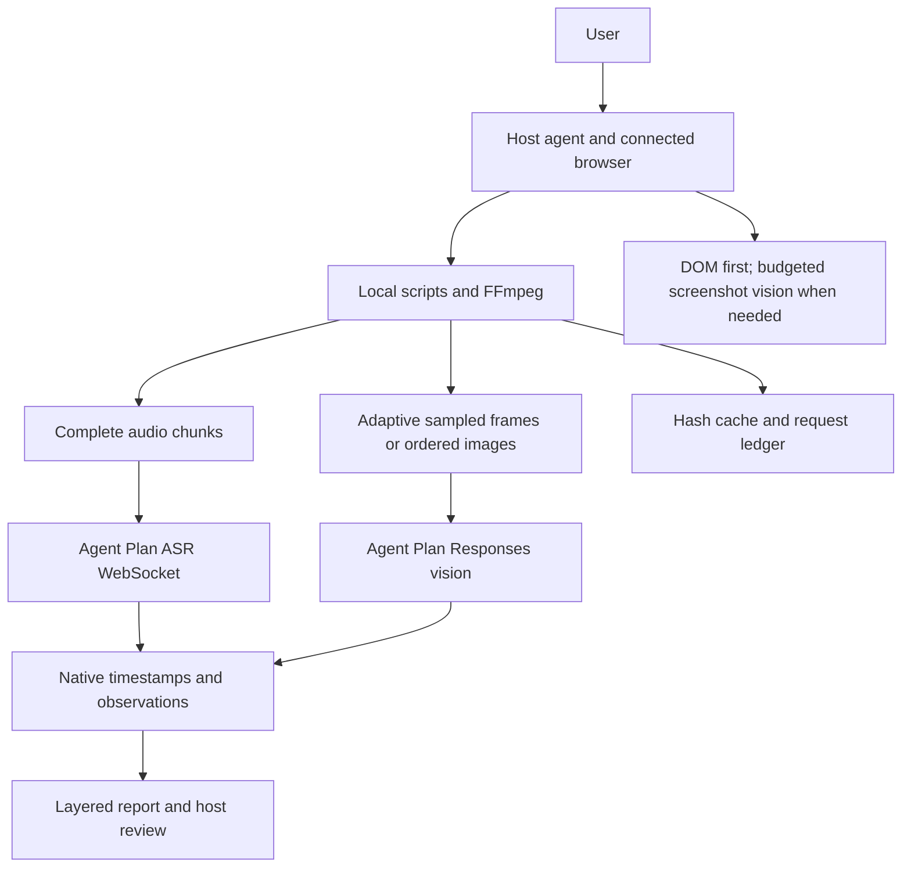
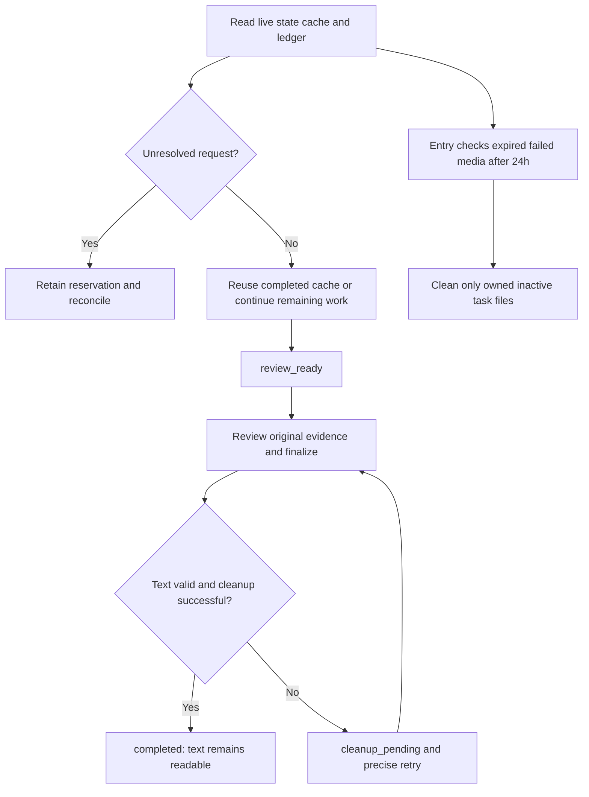

[English](README.en.md) · 简体中文


# douyin-agent

由 Codex、WorkBuddy 等桌面 Agent 编排的多平台视频与图文理解技能。提供主题、分享链接或本地素材，核对作品、取得完整媒体，交给火山 Agent Plan 转写和理解，复核后留下 Markdown/JSON 并清理任务媒体。

## 用自然语言安装
```text
帮我安装 https://github.com/HNNUYUXUAN/douyin-agent
先读 AGENTS.md、AGENT_INSTALL.md，WorkBuddy 新设备再读 references/bootstrap/zh-CN/first-run.md。
终端优先已有 Git Bash，其次 PowerShell 7、Windows PowerShell 5.1。
检查已有 Conda，准备独立 Python 3.12、FFmpeg/FFprobe、浏览器和 Agent Plan。
需要登录、购买、Key 或系统授权时，打开相应页面或本地文件让我完成。
```
[GitHub](https://github.com/HNNUYUXUAN/douyin-agent) · [GitCode](https://gitcode.com/yuxuan6426/douyin-agent) · [从零安装](references/bootstrap/zh-CN/first-run.md)

Windows 为当前主要环境；浏览器使用宿主实际连接的 Chrome/Edge。Key 在本地填写，已有配置复用。独立工作区和技能目录分开；WorkBuddy 新安装默认用户级 `.workbuddy/skills/douyin-agent`，以实际客户端发现为依据。

## 五张图了解完整链路

### 1. 安装与首次配置



读指南、准备环境、连接与服务分别验证；用户自行登录、购买和填写 Key。

### 2. 从用户任务到交付



浏览记录、精选深析、逐条深析由用户选择，没有默认消费模式。

### 3. 媒体如何取得



解析按钮成功不等于文件取得；所有尝试计数，失败项留待处理，其他作品继续。

### 4. 系统与数据流



音频完整覆盖；视频视觉为采样。ASR、视觉、汇总分别版本化，保留原生时间和不确定性。

### 5. 生命周期与恢复



不自动重提收费请求；失败媒体到期规则不因查看而延期。无常驻调度，doctor/status 只读。

## 日常使用与深入指南

“帮我开工”后一次补齐平台、模式、入口/主题、精选条件、时长/条数、图文停留与云用量。范围内持续执行，受阻项集中反馈；用户停止后保存进度，恢复须明确发起。

[浏览会话](docs/agent/zh-CN/browse.md) · [平台控件](docs/agent/zh-CN/platforms.md) · [视觉辅助](docs/agent/zh-CN/vision.md) · [取得与完整性](docs/agent/zh-CN/acquisition.md) · [理解交付](docs/agent/zh-CN/workflow.md) · [恢复清理](docs/agent/zh-CN/recovery.md)

源码、环境和私密配置保留；用户导入原件保留。任务视频、音频、抽帧、图片及已登记下载副本经复核后清理。长期结果包含 MD/JSON、原生时序、证据索引及请求/清理记录。

## 案例与验证范围

[短视频](docs/cases/short.zh.md)、[长视频](docs/cases/long.zh.md)、[图文](docs/cases/note.zh.md) 保留历史真实案例摘要。当前版本的离线、终端、浏览器、云调用及异机范围分别记录于[验收索引](references/acceptance.md)。TikTok 本轮未实测；获取受平台和来源实际条件限制。

## Agent 文档与许可

[AGENTS.md](AGENTS.md)、[SKILL.md](SKILL.md)、[机器索引](docs/agent/index.json)、[llms.txt](llms.txt) 按意图路由。[OKF Wiki](wiki/index.md) 提供分块知识，私有案例留本地。原创代码采用 [MIT](LICENSE)，依赖见[第三方说明](THIRD_PARTY_NOTICES.md)；第三方作品保留其原有权利。
