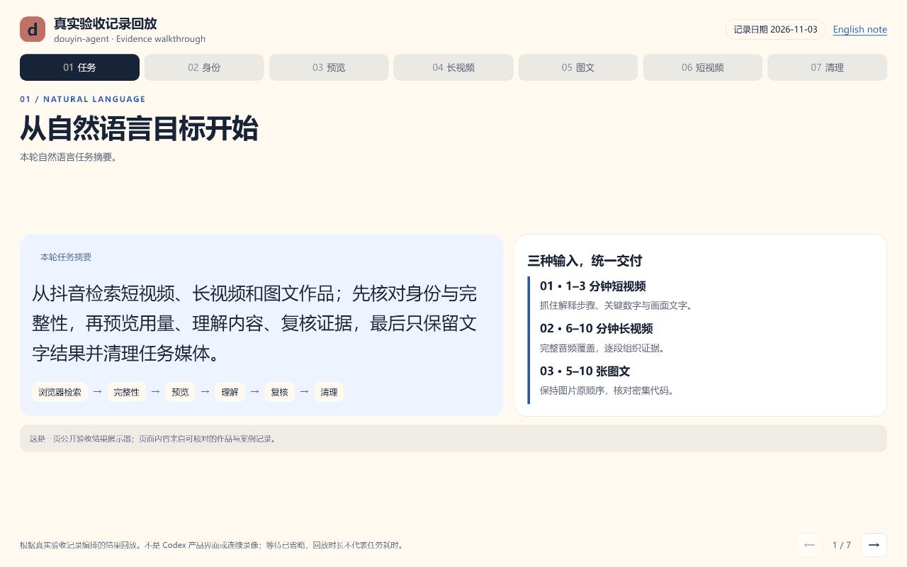
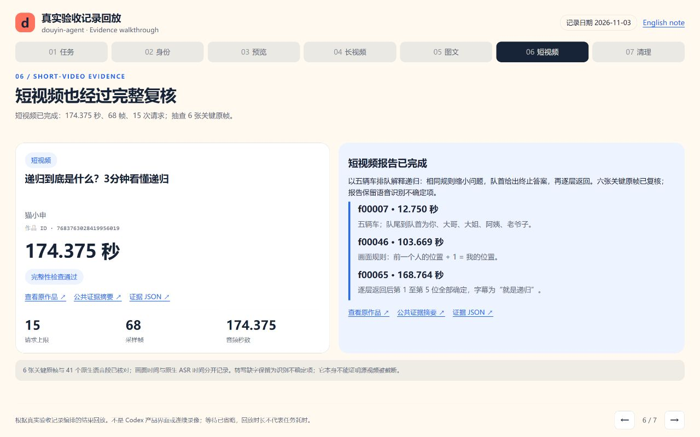
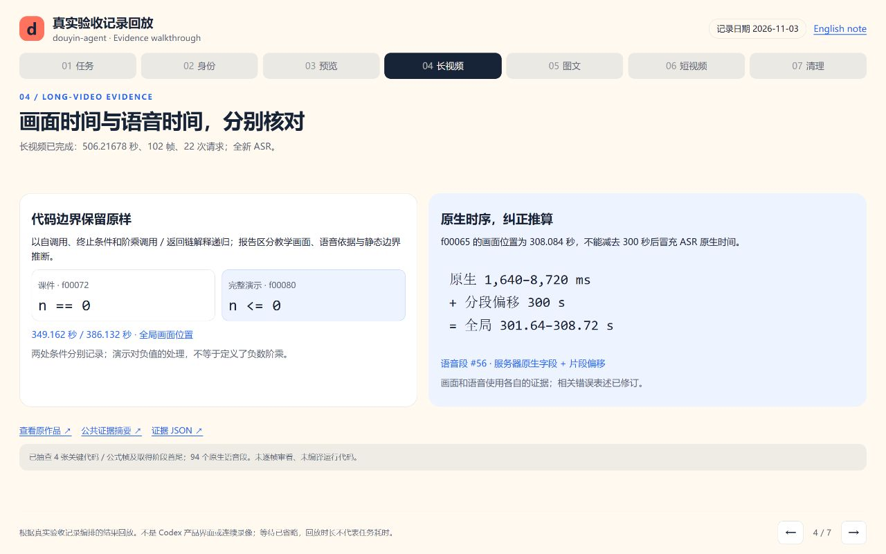
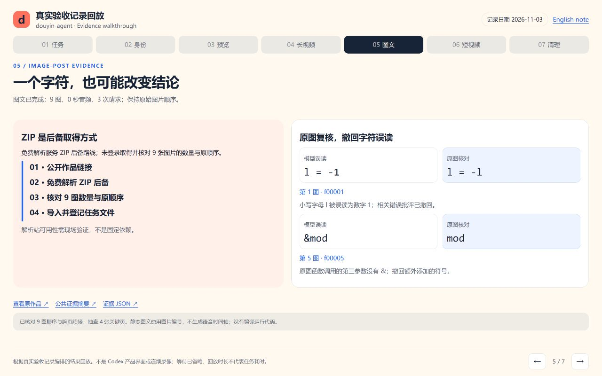
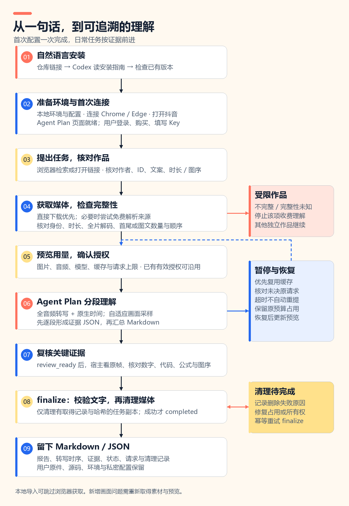
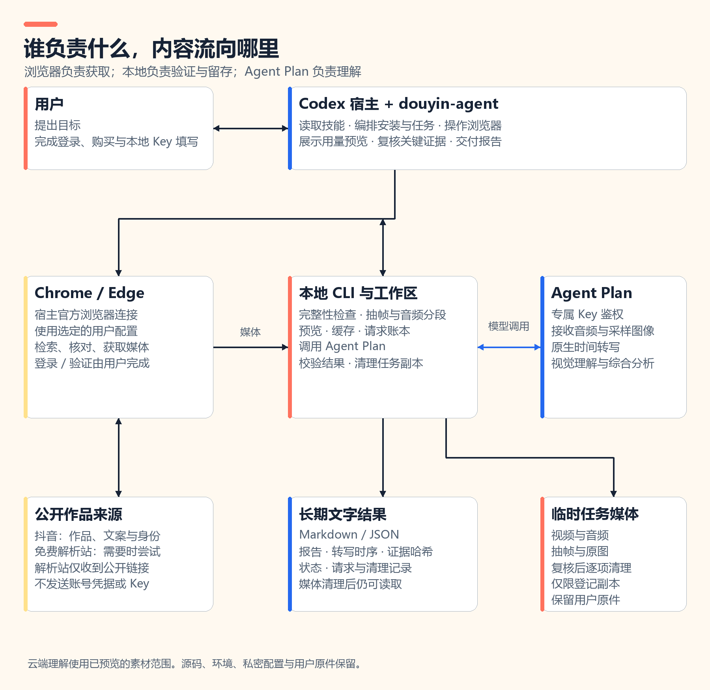

[English](README.en.md) · 简体中文


# douyin-agent

**把抖音视频与图文，变成带证据的笔记。**

给 Codex 一个主题、一段分享文案或一个作品链接。它会通过连接的浏览器查找和核对作品，取得媒体并检查完整性，再用火山 Agent Plan 转写、理解画面、整理分段报告。复核完成后，保留 Markdown / JSON，清理任务下载的媒体。

[开始使用](#开始使用) · [看看实际过程](#看看实际过程) · [首次配置](#首次配置) · [工作原理](#工作原理)

## 开始使用

把下面这段话连同本仓库链接发给 Codex：

```text
帮我安装 douyin-agent：https://github.com/HNNUYUXUAN/douyin-agent
请先阅读 AGENTS.md 和 AGENT_INSTALL.md，检查已有版本，
使用 install.ps1 安装，并带我完成首次配置。
工作区优先放在 D:\douyin-agent；没有 D 盘时让我选择其他位置。
引导我连接 Chrome 或 Edge、打开抖音，以及配置 Agent Plan。
需要登录、购买或填写 Key 时，把对应页面或本地文件准备好，由我完成。
```

也可从 [GitCode](https://gitcode.com/yuxuan6426/douyin-agent) 安装；一次安装使用同一来源和版本。Agent 从 [安装入口](AGENT_INSTALL.md) 开始，按 [操作索引](docs/agent/index.json) 选择当前步骤。

安装后直接说：

```text
帮我在抖音找一条讲二分查找的视频。
核对完整性后，先展示用量预览，再分析讲解步骤和关键代码。
完成后只留总结和证据 JSON，清理任务下载的媒体。
```

在线获取使用 **Windows Codex + 已连接的 Chrome / Edge**；本地导入可跳过浏览器获取。需要独立 Python 3.12 环境、FFmpeg / FFprobe 和有效的 Agent Plan 专属 Key。Chrome 已有本机实测；其他浏览器与设备的验证范围见[验收记录](references/acceptance.md)。

## 看看实际过程



七屏展示依据三项真实验收记录编排，覆盖自然语言任务、作品身份、用量预览、报告复核与清理结果。它是验收证据回放；等待已省略，不是 Codex 产品界面或连续录屏，播放时长不代表任务处理耗时。[回放页面源码](docs/demo.html)。克隆后在仓库根运行 `python -m http.server 8766 --bind 127.0.0.1`，再访问 `http://127.0.0.1:8766/docs/demo.html` 可交互查看。

报告把内容分成可追溯的段落：哪里说了什么、对应哪个时间点、哪些是画面观察、哪些仍需确认。转写使用服务返回的原生时间；视觉观察关联图片编号，方便复核。

## 三种任务，从检索到结果


### 短视频：抓住重点，也核对细节

```text
在抖音找一条 1–3 分钟的科普短视频，分析核心观点、论据和画面文字。
先给我作品清单与调用量预览，再开始理解。
```

交付关注：核心观点、时间点、关键数字、语音与画面的对应关系。



实测作品：猫小申的 [《递归到底是什么？3分钟看懂递归》](https://www.douyin.com/video/7683763028419956019)，实际时长约 **2分54秒**。本轮分析 **68 帧**并转写完整的 **174.375 秒**音频，共 **15 次请求**。复核 6 张关键原帧，确认五辆车的顺序、终止条件和逐层返回；语音识别缺字保留为不确定项。报告完成，任务媒体已清理，清理后校验通过。

[阅读短视频证据摘要](docs/cases/short.zh.md) · [查看证据 JSON](docs/cases/short.json)。截图展示真实报告的关键证据与复核结果。

### 长视频：拆成段落，再串起完整思路

```text
在抖音找一条 6–10 分钟的技术讲解视频。
按时间段整理思路，核对代码、公式和易混淆的结论，保留不确定项。
```

交付关注：全音频转写、分段理解、关键内容证据和总览；画面采用覆盖全片的自适应采样。



实测作品：林粒粒呀的 [《8分钟搞懂“编程的鬼打墙”——递归》](https://www.douyin.com/video/7493866919565610291)，实际时长约 **8分26秒**。本轮从浏览器检索并取得作品，完成全新音频转写和 **102 帧**采样理解；共 **22 次请求**（2 次 ASR、17 次视觉理解、2 次分层汇总、1 次报告）。关键证据已复核，任务完成并清理媒体，清理后校验通过。

[阅读长视频证据摘要](docs/cases/long.zh.md) · [查看证据 JSON](docs/cases/long.json)。截图展示代码边界与时序复核：保留 `n == 0` 和 `n <= 0` 的区别，分别记录原生 ASR 时间与画面时间。本次没有编译运行视频中的代码。

### 图文：保留图片顺序，读懂文案与画面

```text
在抖音找一篇包含 5–10 张图片的图文作品。
按原顺序说明每张图的信息，再结合作者文案汇总，标明看不清或无法确认的文字。
```

交付关注：图片数量与原顺序、逐图观察、画面文字、作者文案及其与图片的关系。



实测作品：C语言模型笔记📝的 [《C语言 数论与大数运算，一组笔记讲清楚》](https://www.douyin.com/note/7699716622642105615)。通过免费解析服务的 ZIP 后备路线取得 **9 张图片**，核对数量与原顺序；共 **3 次请求**、**0 秒音频**。抽查 4 张关键页，纠正把字母 `l` 读成数字 `1`、以及额外读出 `&` 的错误。报告完成，任务图片与登记下载副本已清理，清理后校验通过。

[阅读图文证据摘要](docs/cases/note.zh.md) · [查看证据 JSON](docs/cases/note.json)。截图展示顺序检查和字符纠错，解析站不是固定依赖。

三项均从浏览器检索新作品开始，累计提交 **40 次请求、680.59178 秒音频、179 张图片 / 帧**，均已完成复核、清理与清理后校验。这些数字记录本轮提交量；平台结算、其他任务的用量和耗时分别记录。

## 首次配置

Codex 按 [首次使用指南](docs/agent/zh-CN/onboarding.md) 准备环境、打开入口并检查状态；你完成账号登录、购买和本地填写 Key。已配置的项目直接复用。`onboard --check` 是只读检查；浏览器连接、抖音访问和真实模型调用由宿主分别核验并记录。

| 准备项 | Codex 帮你做 | 你需要完成 |
|---|---|---|
| 本地工作区 | 选择短路径，发现现有 Conda，准备独立环境与配置文件 | 确认工作区；缺少工具时按官方指引安装 |
| 浏览器连接 | 引导进入官方浏览器扩展设置，并检查页面读取 | 连接 Chrome / Edge，完成网站授权 |
| 抖音 | 在同一浏览器配置中打开作品或搜索页 | 按需登录，完成验证码 |
| Agent Plan | 打开购买页、控制台和本地配置文件 | 自行选购套餐，复制专属 Key 到 `.env` |
| 首次验证 | 检查本地环境，展示小样本用量后验证服务 | 确认本次或持续用量范围 |

[浏览器连接说明](https://learn.chatgpt.com/docs/chrome-extension) · [打开抖音](https://www.douyin.com/) · [Agent Plan 购买页](https://www.volcengine.com/activity/agentplan) · [Agent Plan 控制台](https://ark.volcengine.com/region:cn-beijing/openManagement?LLM=%7B%7D&advancedActiveKey=agentPlan) · [官方配置说明](https://docs.volcengine.com/docs/ark/agent-plan-personal-get-started?lang=zh)

Key 填在工作区 `.env` 的 `VOLC_AGENT_API_KEY`，不要发到聊天。必须使用 **Agent Plan 专属 Key**。技能开源免费，Codex 与云端模型服务按各自规则收费；套餐价格和权益以购买页面为准。

<details>
<summary>手动安装与环境重建</summary>

在下载的仓库根目录中使用 PowerShell 7：

```powershell
./install.ps1 -Workspace 'D:\douyin-agent'
```

安装器准备独立环境，并将发布清单中的技能文件安装到宿主发现目录。默认使用 `$CODEX_HOME/skills/douyin-agent`；未设置 `CODEX_HOME` 时使用当前用户的 `.codex/skills/douyin-agent`。需要指定安装位置或已有 Conda 时：

```powershell
./install.ps1 -Workspace 'D:\douyin-agent' `
  -SkillDir 'C:\Users\YOUR_USER\.codex\skills\douyin-agent' `
  -Conda 'C:\PATH_TO_CONDA\Scripts\conda.exe'
```

将示例路径替换为实际路径。工作区与技能目录分开；没有 D 盘时改用其他短路径，也可省略 `-Workspace` 交互选择。安装结果记录实际路径；后续从安装回执和 `agent-context.json` 定位 Python、技能与工作区，执行 `onboard --check`，再由宿主完成首次引导。宿主需要刷新或重启时按实际提示操作。

已有源码仅需重建环境时使用 `./setup.ps1 -Workspace 'D:\douyin-agent'`；`setup.ps1` 不负责安装到宿主技能目录。两个入口均复用已有 Conda；FFmpeg / FFprobe 需在 PATH。`doctor` 和 `onboard --check` 不发起收费请求。详见[安装与升级](docs/agent/zh-CN/install.md)。

</details>

## 工作原理



先尝试可用的直接获取路线；遇到 `blob` 或获取失败，由宿主复用已验证的免费解析来源，必要时重新检索，每轮最多尝试三个来源。只有作品身份、时长或图文数量、解码及首尾等检查通过，才进入收费理解。图文可在必要时使用解析服务提供的 ZIP 后备路线；宿主按取得指南检查压缩包、图片数量与顺序，再登记文件所有权。具体解析站按当时可用性验证，不作为固定依赖。



Codex 负责意图理解、浏览器操作和证据复核；本地脚本负责媒体检查、抽帧、缓存、请求账本和清理；Agent Plan 接收音频与采样画面，返回转写及分析。上传范围先进入用量预览，新增素材或扩大范围会更新预览。

## 留下理解，清理媒体

| 长期保留 | 复核后清理 | 始终保护 |
|---|---|---|
| Markdown 报告、分段理解、转写原生时间、证据编号与哈希、请求和清理记录 | 任务拥有的视频、音频、抽帧、原图及已登记下载副本 | 用户导入原件、运行环境、源码与私密配置 |

已完成结果可在媒体删除后继续读取；新的画面问题可能需要重新获取。清理失败会记录原因并保持待清理状态；失败任务的媒体按首次失败起 24 小时到期，下次任务入口处理，没有后台定时任务。

视觉理解采用采样，不能保证读到每一帧；缺少可靠时序时保留文本并说明限制。删除、私密、付费、直播和始终无法完整取得的作品会明确报告受限。云请求超时不自动重发，未决占用和历史提交在媒体清理后仍保留。

## 文档与许可

Agent 文档按任务分流，安装与运行都能从稳定入口继续：

| 入口 | 用途 |
|---|---|
| [AGENTS.md](AGENTS.md) | 读取仓库的规则与任务路由 |
| [AGENT_INSTALL.md](AGENT_INSTALL.md) | 从仓库安装、升级与首次接入 |
| [SKILL.md](SKILL.md) | 已安装技能的自然语言触发与执行规则 |
| [llms.txt](llms.txt) | Agent 可快速读取的文档地图 |
| [操作索引 JSON](docs/agent/index.json) | 按语言与任务选择操作指南 |

- [首次使用](docs/agent/zh-CN/onboarding.md)：浏览器、Agent Plan、本地配置与分别验证。
- [完整执行流程](docs/agent/zh-CN/workflow.md)：命令、回执、预览和复核。
- [检索、取得与完整性](docs/agent/zh-CN/acquisition.md)：浏览器检索、直接下载、解析后备与图文顺序。
- [恢复、清理与迁移](docs/agent/zh-CN/recovery.md)：未决请求、缓存和生命周期。
- [验收范围](references/acceptance.md)：本机实测、同机重定位与未验证环境。
- [MIT 许可](LICENSE) · [第三方依赖许可](THIRD_PARTY_NOTICES.md)。代码许可不授予第三方作品的转载权。

Windows Codex 是当前已验证的主要环境。同机独立 Conda 环境在含空格路径重建通过；安装、重复安装、用户修改冲突检测、旧 v2 升级和文件占用时回滚已实测。异机与其他宿主仍需各自验证。欢迎带上复现步骤与脱敏日志反馈问题；请勿提交 Key、Cookie、签名下载地址或私人媒体。
