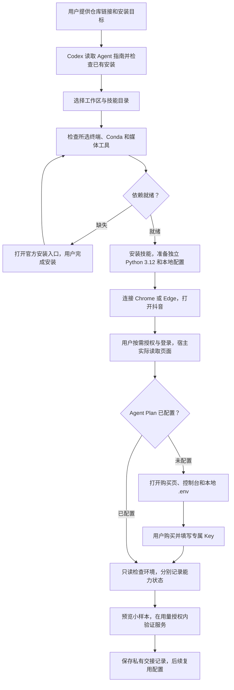
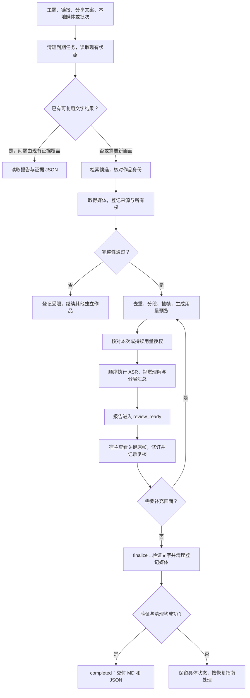
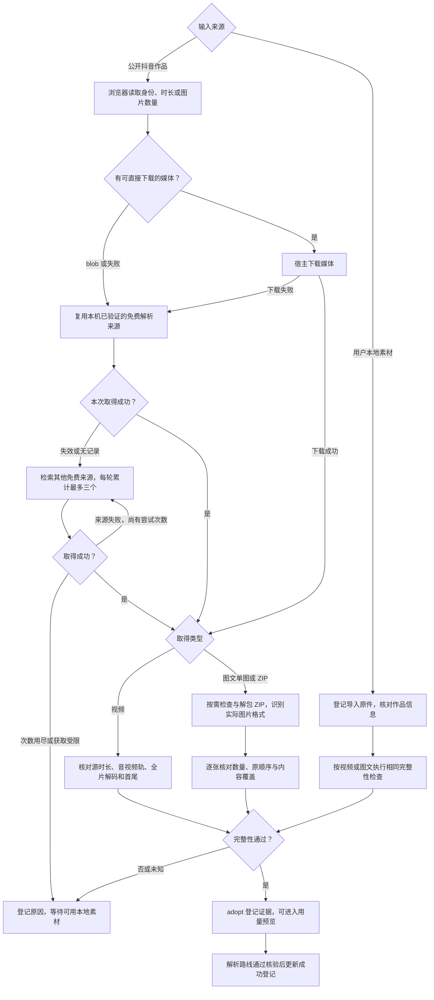
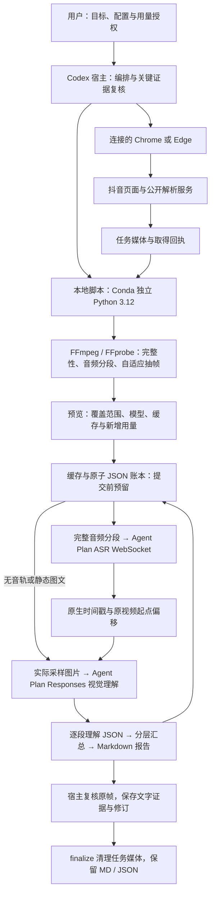
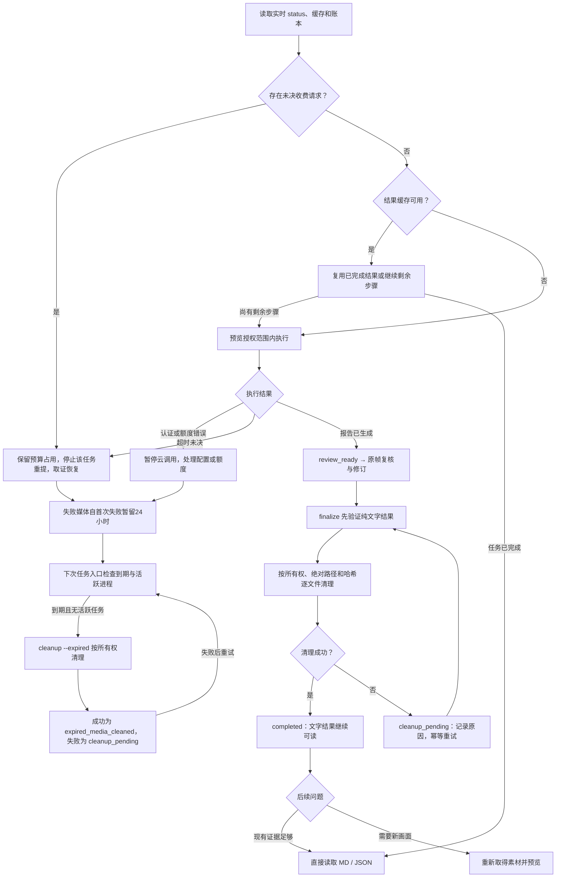

[English](README.en.md) · 简体中文


# douyin-agent

**让 Codex 理解抖音视频与图文，留下可追溯的知识。**

提供一个主题、作品链接、分享文案或本地素材，Codex 通过连接的 Chrome / Edge 核对与获取作品，本地脚本检查完整性，火山 Agent Plan 完成语音转写和画面理解。关键证据复核后，保存 Markdown / JSON，清理任务拥有的临时媒体。

支持短视频、长视频、图文和批量任务。音频完整覆盖，画面按内容自适应采样；报告分别标记语音识别、视觉观察与推断。

## 用一句话安装

将仓库链接和下面这段话发给具备本地终端、文件及浏览器能力的 Codex：

```text
帮我安装 https://github.com/HNNUYUXUAN/douyin-agent
先阅读 AGENTS.md 和 AGENT_INSTALL.md，检查已有版本和本机依赖。
复用我正在使用的 PowerShell 或 Git Bash，以及已有 Conda；准备独立工作区。
带我连接 Chrome 或 Edge、打开抖音，完成 Agent Plan 配置。
需要登录、购买或填写 Key 时，打开相应页面或本地文件，由我完成。
```

[GitHub](https://github.com/HNNUYUXUAN/douyin-agent) · [GitCode 镜像](https://gitcode.com/yuxuan6426/douyin-agent) · [Agent 安装入口](AGENT_INSTALL.md)

新设备仅安装 WorkBuddy 与 Chrome/Edge 连接器时，从 [分块指引](references/bootstrap/zh-CN/first-run.md) 开始。覆盖源码获取、Conda/FFmpeg、WorkBuddy 技能发现及首条任务；问题经验可按 [Google OKF Wiki](wiki/index.md) 检索与存储。异机实测由新设备验收记录确认。

## 环境准备

| 层次 | 用途与准备方式 |
|---|---|
| Windows 终端 | Windows PowerShell 5.1、PowerShell 7 或 Git Bash，任选其一；宿主先检查实际可执行文件和版本，复用系统或宿主随附工具。 |
| Conda | 发现已有 Miniconda、Anaconda 或兼容 Conda；基础 Python 需 3.10+，用于启动安装器。缺失时打开官方安装指南。 |
| 独立运行环境 | 使用锁文件在工作区创建 Python 3.12 环境；后续直接调用该解释器，无需 `conda activate`。 |
| 媒体工具 | FFmpeg / FFprobe 可从 PATH 调用，负责探测、解码、音频处理与抽帧。 |
| 浏览器 | 在线检索和取得使用宿主连接的 Chrome / Edge；在同一浏览器打开抖音，用户按需登录。本地导入可直接进入素材核对。 |
| Agent Plan | 用户购买可用套餐，将专属 Key 填入工作区 `.env` 的 `VOLC_AGENT_API_KEY`；进程环境变量优先。 |

首次向导由 Codex 打开所需入口：[浏览器连接](https://learn.chatgpt.com/docs/chrome-extension)、[抖音](https://www.douyin.com/)、[Agent Plan 购买页](https://www.volcengine.com/activity/agentplan)、[控制台](https://ark.volcengine.com/region:cn-beijing/openManagement?LLM=%7B%7D&advancedActiveKey=agentPlan)、[配置说明](https://docs.volcengine.com/docs/ark/agent-plan-personal-get-started?lang=zh)。缺少工具时使用 [Miniconda](https://www.anaconda.com/docs/getting-started/miniconda/install)、[PowerShell](https://learn.microsoft.com/powershell/scripting/install/installing-powershell-on-windows)、[Git for Windows](https://gitforwindows.org/)、[FFmpeg](https://ffmpeg.org/download.html) 官方入口。

已有配置按检查结果复用。用户自行完成登录、验证码、购买和本地 Key 输入。技能开源免费；Codex 与云服务按各自规则收费，套餐权益以官方页面为准。

从下载的仓库根目录选择对应命令：

**PowerShell 5.1 / 7**

```powershell
./install.ps1 -Workspace 'D:\douyin-agent'
# 可选：-SkillDir 'C:\Users\YOUR_USER\.codex\skills\douyin-agent'
# 可选：-Conda 'C:\PATH_TO_CONDA\Scripts\conda.exe'
```

**Git Bash**

```bash
bash ./install.sh --workspace '/d/douyin-agent'
# 可选：--skill-dir '/c/Users/YOUR_USER/.codex/skills/douyin-agent'
# 可选：--conda '/c/PATH_TO_CONDA/Scripts/conda.exe'
```

省略工作区参数会交互选择：有 D 盘时建议 `D:\douyin-agent`，否则建议用户目录下的短路径。安装目录默认取 `$CODEX_HOME/skills/douyin-agent`，未设置时取当前用户 `.codex/skills/douyin-agent`。工作区和技能目录分开；含空格路径需加引号。

仅准备或重建环境时使用 `./setup.ps1 -Workspace 'D:\douyin-agent'` 或 `bash ./setup.sh --workspace '/d/douyin-agent'`。两个终端入口共用 Python 安装核心。Conda 选择顺序为显式参数 → `CONDA_EXE` → PATH → 用户目录和 ProgramData 下的常见安装位置。

## 完整工作链路

以下图源可直接维护。当前客户端若未显示 Mermaid，可阅读每图下方的文字步骤，或查看 [GitCode 页面](https://gitcode.com/yuxuan6426/douyin-agent/blob/main/README.md)。

### 1. 安装与首次配置



步骤：读指南 → 选目录 → 检查终端和 Conda → 安装环境 → 连接浏览器与抖音 → 配置 Agent Plan → 预览并验证。`doctor`、`status`、`onboard --check` 只读；浏览器访问、登录状态和真实调用分别核验。

### 2. 从任务到交付



步骤：核对作品 → 取得与完整性检查 → 预览 → 授权 → 理解 → 复核 → `finalize` → 交付。新增素材和扩大调用范围会形成新预览；批次按作品 ID 或媒体哈希去重，浏览器操作与云请求默认顺序执行。

### 3. 媒体如何取得



直接获取和解析服务均由宿主操作。解析站只接收公开作品链接；成功来源登记在本机，其他主机重新验证。视频时长容差取一秒与两个视频帧时长中的较大值，缺少可靠源时长标记完整性未知。图文按原顺序登记；ZIP 由独立解包工具检查后再导入图片。取得受阻的作品保留原因，其他独立作品继续。详见[取得指南](docs/agent/zh-CN/acquisition.md)。

### 4. 系统组成与云端数据流



有音轨的视频先覆盖整段音频，再分析实际采样画面并综合转写；无音轨视频和静态图文跳过 ASR。长音频分段保留服务器原生时间与全局偏移，画面按一分钟证据段组织。分段汇总所需请求提前进入预览，云请求关闭自动重试。

| 接口或记录 | 职责 |
|---|---|
| `wss://openspeech.bytedance.com/api/v3/plan/sauc/bigmodel_nostream` | Agent Plan ASR 单流接口，资源 ID `volc.seedasr.sauc.duration`。 |
| `https://ark.cn-beijing.volces.com/api/plan/v3/responses` | 视觉理解与综合分析；默认 `doubao-seed-2.1-pro`，可配置。 |
| 缓存与账本 | 按媒体哈希、模型、处理配置及独立提示词/协议版本复用；提交量、返回用量、平台结算分别记录。 |
| 复核记录 | 关联时间或图片序号、证据编号、哈希、文字观察及当前报告哈希。 |

### 5. 生命周期、清理与恢复



已完成缓存直接交付；部分完成的任务只执行剩余步骤。未决请求始终保留原占用，当前需要按[恢复指南](docs/agent/zh-CN/recovery.md)取证并由维护者处理，不能用新任务绕过。过期失败任务清理后记录 `expired_media_cleaned`，只有经过报告复核、文字验证与成功清理的任务才能标记 `completed`。`doctor/status` 不触发清理，后台不安装定时任务。

## 输出与清理规则

| 长期保留 | 复核后清理 | 用户保留 |
|---|---|---|
| `analysis.md`、分段理解、转写原生时序 JSON、来源与证据索引、请求和清理记录 | 登记为任务所有的视频、音频、抽帧、原图、临时 ZIP 及浏览器下载副本 | 导入原件、独立环境、源码、私密配置 |

长期报告引用作品链接、时间、图片序号、哈希与文字观察。语音识别、视觉结果和推断分别说明。新的画面问题在清理后需要重新取得素材。删除、私密、付费、直播或始终无法完整获取的作品，会报告实际限制。

## 真实案例摘要

| 案例 | 已验证结果 | 证据 |
|---|---|---|
| [2分54秒递归短视频](https://www.douyin.com/video/7683763028419956019) | 174.375秒音频、68帧、15请求；抽查6张关键原帧。 | [摘要](docs/cases/short.zh.md) · [JSON](docs/cases/short.json) |
| [8分26秒递归长视频](https://www.douyin.com/video/7493866919565610291) | 506.21678秒音频、102帧、22请求；复核公式、代码边界与时间引用。 | [摘要](docs/cases/long.zh.md) · [JSON](docs/cases/long.json) |
| [9张 C 语言笔记](https://www.douyin.com/note/7699716622642105615) | ZIP 后备取得，3请求；核对原顺序并纠正关键字符识别。 | [摘要](docs/cases/note.zh.md) · [JSON](docs/cases/note.json) |

三项均完成复核、媒体清理和清理后验证。这些记录来自 v2.1 实测，提交量与平台结算分别记录；当前版本终端与安装验证见[验收范围](references/acceptance.md)。

## Agent 文档与许可

[AGENTS.md](AGENTS.md) 提供仓库路由；[AGENT_INSTALL.md](AGENT_INSTALL.md) 负责安装；[SKILL.md](SKILL.md) 负责已安装技能的触发；[llms.txt](llms.txt) 和[双语索引](docs/agent/index.json) 提供按意图检索的入口。

操作指南：[安装升级](docs/agent/zh-CN/install.md) · [首次配置](docs/agent/zh-CN/onboarding.md) · [检索取得](docs/agent/zh-CN/acquisition.md) · [理解交付](docs/agent/zh-CN/workflow.md) · [恢复清理](docs/agent/zh-CN/recovery.md) · [开发维护](docs/agent/zh-CN/maintenance.md)。

Windows Codex 是当前验证环境；Chrome 有真实获取与理解证据，Edge、其他宿主和异机按各自实测记录。原始代码采用 [MIT](LICENSE)，依赖见[第三方说明](THIRD_PARTY_NOTICES.md)；代码许可不授予第三方作品转载权。
